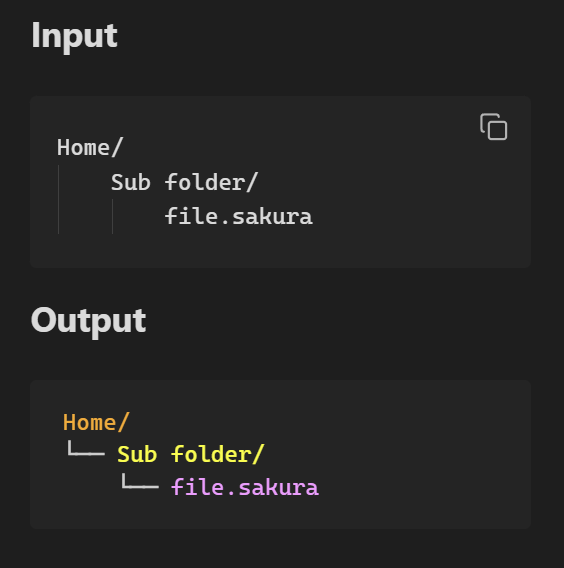

# Sakura

## Overview

Sakura is a tree visualization tool for simplifying the design of file systems
or other tree-like structures. Sakura diagrams are color-coded and great for
project documentation or presentations.

It runs as an Obsidian plugin: write an indented list inside a ` ```sakura `
code block and Sakura renders it as a colored directory tree.



## Install

### Obsidian Community Plugins
1. Settings > Community Plugins > Browse
2. Search "Sakura"
3. Install and Enable

### Manual install
1. Download `main.js`, `manifest.json`, `styles.css` from the [latest release](https://github.com/Colciferr/sakura/releases/latest)
2. Put them in `<vault>/.obsidian/plugins/sakura`
3. Enable in Settings > Community Plugins

## Usage

````
```sakura
home
    documents
        notes.txt
    scripts
        deploy.py
```
````

Folders are detected from nesting (no trailing slash
required), indentation widths don't have to be consistent, and tabs and spaces
can mix. You can also paste the output of the `tree` command, or a Markdown
bulleted list, straight into the block and it renders as-is. See the full
reference below.

## Syntax Reference

[SYNTAX.md](SYNTAX.md)

## LICENSE

[LICENSE](./LICENSE)
